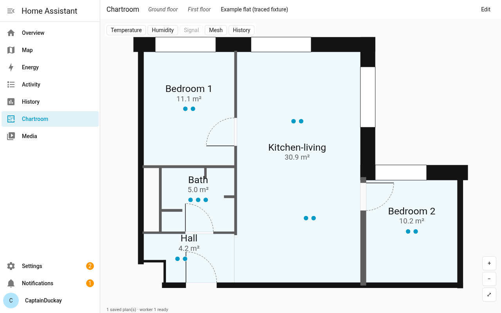
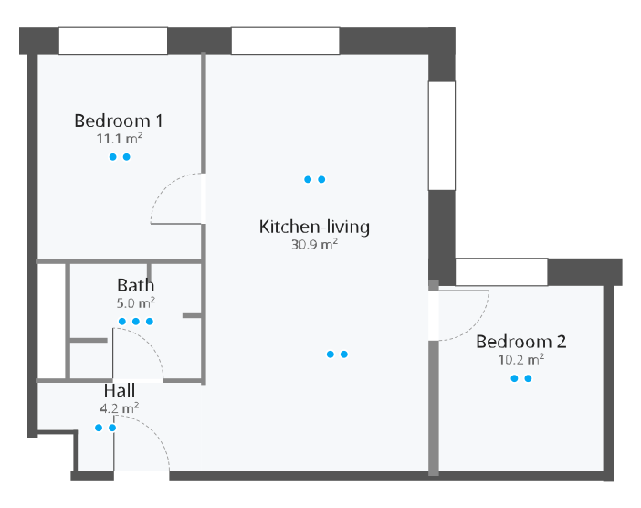

# Chartroom

Floor plans for Home Assistant: draw your home once, then see temperature, humidity and Wi-Fi
signal as live heatmaps over it — in a sidebar panel and as a dashboard card.

> **Status: Phase 0 (scaffold).** The panel and card load, list your floors and areas, and show a
> placeholder plan. Drawing (Phase 1) and heatmaps come next. See
> [docs/render-design.md](docs/render-design.md) for how the heatmaps will be rendered.




## Install (HACS)

1. In HACS, add this repository as a custom repository (category **Integration**).
2. Install **Chartroom** and restart Home Assistant.
3. Go to **Settings → Devices & services → Add integration → Chartroom**.

Chartroom adds a **Chartroom** entry to the sidebar and registers the
`custom:chartroom-card` card — no separate dashboard resource is needed:

```yaml
type: custom:chartroom-card
title: Chartroom
```

Requires Home Assistant 2026.10 or newer. Chartroom has no Python requirements and no runtime
JavaScript dependencies; everything it needs ships in this repository.

## What's inside

| Path                                   | What                                                                                      |
| -------------------------------------- | ----------------------------------------------------------------------------------------- |
| `custom_components/chartroom/`         | The integration: config flow (single instance), plan storage, websocket API, panel, card. |
| `custom_components/chartroom/frontend` | Built frontend, committed so HACS can serve it. Do not edit by hand.                      |
| `frontend/src/`                        | `<chartroom-panel>` and `<chartroom-card>`: TypeScript Web Components, no framework.      |
| `tests/`, `frontend/test/`, `e2e/`     | pytest, Vitest, and Playwright against a real Home Assistant.                             |

Websocket commands: `chartroom/plans/list`, `chartroom/plans/get`, `chartroom/plans/save` and `chartroom/plans/delete` (save and delete need an admin).

## Example data

[](docs/images/example-plan.svg)

[`frontend/test/fixtures/example-plan.json`](frontend/test/fixtures/example-plan.json) is a real
one-floor flat of about 62 m², traced by hand into the plan model (`frontend/src/plan.ts`): walls in
metres with material and thickness, rooms, doors with their swing, windows, and sample
temperature/humidity sensors. Only the geometry and generic room types were kept; the source
drawing is not in the repository. Tests check each room against the area stated on the drawing.

```sh
pnpm example-plan                                   # regenerate the fixture and the SVG preview
HA_URL=http://127.0.0.1:8123 HA_TOKEN=... node scripts/example-plan/load-into-ha.mjs
```

The last command saves the fixture to a dev Home Assistant as plan `example` via
`chartroom/plans/save`.

## Development

Needs Node.js 24, pnpm and [uv](https://docs.astral.sh/uv/).

```sh
pnpm install
pnpm check          # format, lint, type-check (Vite+)
pnpm test           # Vitest
pnpm build          # builds into custom_components/chartroom/frontend — commit the result
pnpm size           # bundle-size budget

uv sync --group test --group lint --no-install-project
uv run ruff check . && uv run ruff format --check .
uv run pytest
```

End-to-end tests need a running Home Assistant with Chartroom copied into its
`custom_components`. They onboard a fresh instance, or use `HA_TOKEN` for an existing one:

```sh
pnpm exec playwright install chromium
HA_URL=http://127.0.0.1:8123 pnpm e2e
```

CI runs all of the above, plus hassfest and HACS validation, and starts Home Assistant in Docker
for the end-to-end tests.

## Credits and contact

Made by CaptainDuckay. Questions: hello@captains-chest.com.

## License

[MIT](LICENSE)
