# Chartroom

Floor plans for Home Assistant: draw your home once, put your lights, switches, doors and windows
on it, and see temperature, humidity and Wi-Fi/radio signal as live heatmaps over it, plus your
Zigbee and Z-Wave mesh links — in a sidebar panel and as a dashboard card.

> **Status: Phase 5 (history and phones) is complete.** Phase 1 gave the panel one tab per Home
> Assistant floor, pan and zoom, an optional underlay and an editor for walls, doors, windows,
> rooms and sensor/signal sources. Phase 2 added live device markers (tap to toggle, hold for
> details). Phase 3 added live temperature and humidity fields between your sensors. Phase 4 added
> an estimated signal-strength map from your access points and radios through your walls, and the
> ZHA, Z-Wave JS and Zigbee2MQTT mesh drawn between your devices. Phase 5 adds a history slider
> that plays the plan back from Home Assistant's recorder, and a phone layout for the panel. See
> [docs/render-design.md](https://github.com/captains-chest/chartroom/blob/main/docs/render-design.md) for how the heatmaps are rendered and how fast
> they are.

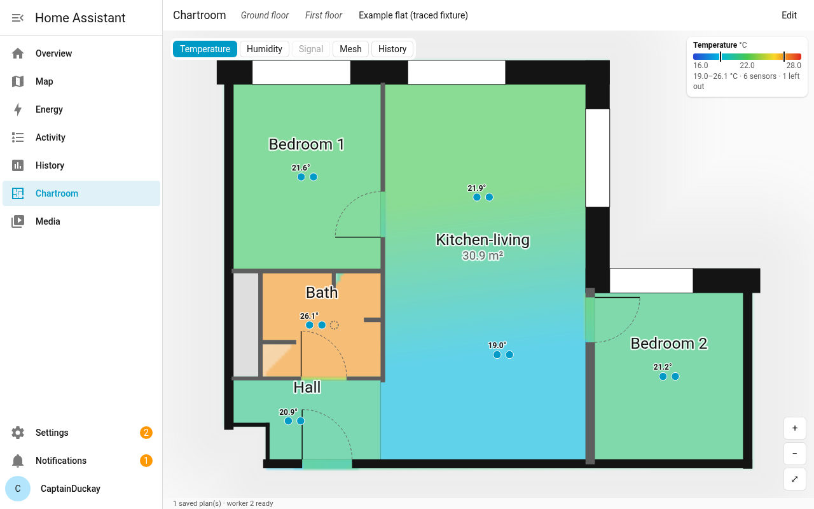

## Drawing your plan

Open **Chartroom** in the sidebar, pick a floor and press **Edit** (or **Create plan** on a floor
without one). Admins only; changes save automatically.

Chartroom draws one plan per Home Assistant floor. Floors are optional: with none, the panel
offers a single **Home** plan covering every area. To draw each floor on its own, create floors
under **Settings → Areas, labels & zones** and assign your areas to them.

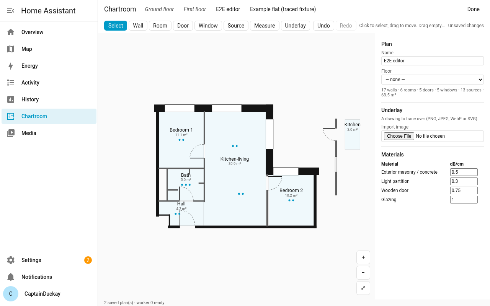

- **Wall**: click to start, click to add corners, double-click or Esc to finish. Endpoints snap to
  other walls and stay joined when you drag them. Each wall has a material and a thickness.
- **Door** / **Window**: click on a wall. Width, swing and an optional open/closed entity are set
  in the inspector.
- **Room**: click the corners, double-click to close, then link the room to a Home Assistant area.
  An open-plan room can link several areas (say _Kitchen_ and _Living room_): its devices are
  auto-placed in it, and a room with its default name takes the areas' names.
- **Source**: place a temperature/humidity sensor, a Wi-Fi access point or a radio (Zigbee,
  Z-Wave, Thread…). Sensors are picked from the Home Assistant temperature and humidity sensors in
  the plan's floor's areas; access points and radios take any entity and a level at 1 m. Drag to
  move, Delete to remove.
- **Underlay**: import a PNG, JPEG, WebP or SVG drawing to trace over, then calibrate the scale
  with **Measure** (two points and their real distance) or by a room's known area. In the panel
  outside the editor, the **Underlay** button and slider hide the drawing or change its opacity
  (just for you, not saved in the plan).
- **Device**: put lights, switches, fans, input booleans, covers, locks and binary sensors (doors,
  windows, motion…) on the plan. **Auto-place by area** drops every device whose area is linked to
  a room into that room; drag the rest from the list onto the plan (or pick one and click where it
  goes), then drag markers to where the devices really are. The inspector changes a marker's
  entity or deletes it. On a plan for a floor, the list only offers that floor's areas.
- **Undo** / **Redo**: Ctrl+Z and Ctrl+Shift+Z. Undo brings back a replaced underlay image too:
  the previous images are kept until Home Assistant restarts.
- **Plan file**: **Export** downloads the plan as `.json` (the plan as stored); **Export with
  underlay** embeds the underlay image in it as a data URL. **Export with underlay file** downloads
  the image as its own file (`chartroom-<plan>.png`, or `.jpg`, `.webp`, `.svg`) next to the
  `.json`, which keeps the underlay's placement and names the image in `underlay_file`; the
  browser may ask to allow the second download. **Import** reads such a file (or a plan made by a
  script) and replaces this floor's plan with it, after checking its structure and validating it;
  problems are listed and nothing is saved. Undo brings the old plan back. For a plan exported with
  an underlay file, select the `.json` and the image together; if the browser renamed the image
  (`chartroom-home (1).png`), the one image picked is taken as long as its type matches, with a
  note saying so; otherwise the problem says which type each is. An imported underlay comes along only with its image (embedded or picked alongside), or when
  it is already this plan's.
- **Materials**: the loss per centimetre for each wall material, used by the signal heatmap.
- The outer outline is worked out from the walls; there is no outline tool.
- A floor with more than 512 walls or 256 devices shows a warning: the heatmaps may be slow on
  phones and tablets. The signal map takes at most 32 access points and radios and 2048 wall
  segments (walls split at their doors and windows); above that the editor warns that it leaves
  out the rest (see [docs/render-design.md](https://github.com/captains-chest/chartroom/blob/main/docs/render-design.md)).

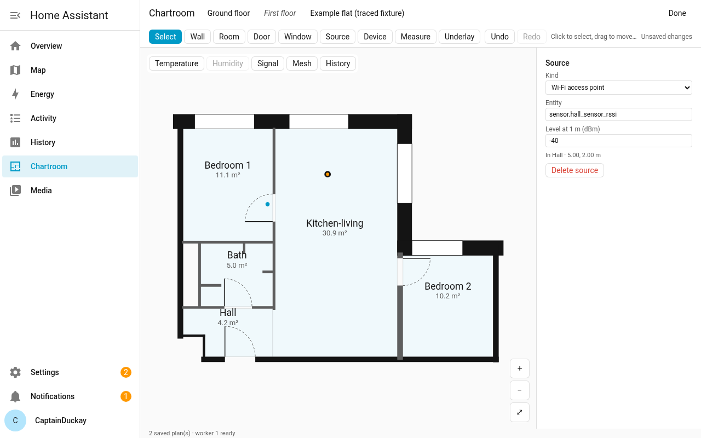

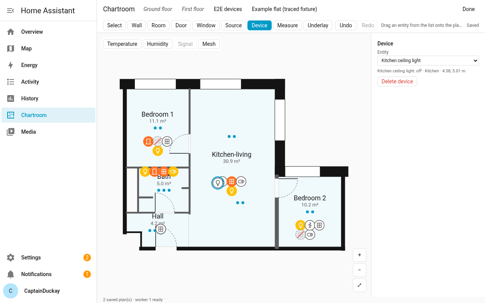

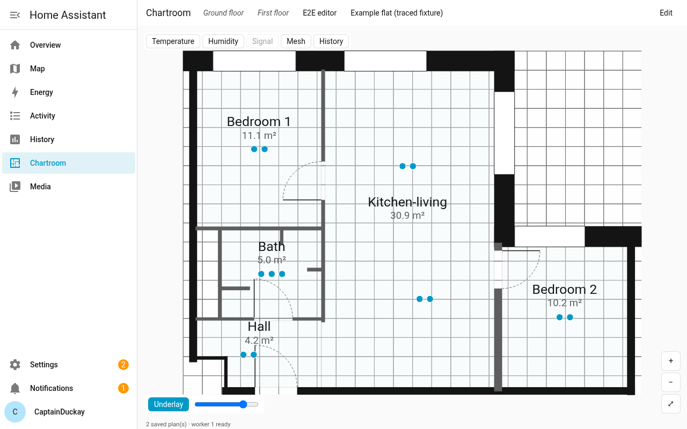

## Heatmaps

The **Temperature**, **Humidity** and **Signal** buttons at the top left of the panel show a live
field built from the sources placed on the plan (with **Source** in the editor). Press the active
button again to hide it. Your choice is remembered on this device.

- **Linear between sensors.** Two sensors at 25 °C and 30 °C give exactly 27.5 °C halfway between
  them, and a straight gradient along the line. With more sensors each point mixes its three
  nearest by inverse distance, so the colour changes smoothly as you move between them. One
  sensor colours the plan in one colour.
- **Heat goes through doors, not walls.** Distances are measured along paths that only pass
  through openings: open doors, gaps, doors without an entity and open windows. Closed doors (per
  their entity), closed windows and walls block. Through an open doorway the colour blends
  smoothly from one room into the next, spreading out from the doorway and fading with distance
  into the far room, which returns to its own sensors. A wall or a closed door stays a sharp edge.
  A room with no sensor of its own is filled through its doorways, paler.
- **Honest about guessing.** The colour fades where the nearest sensor is far away. Anything no
  sensor reaches (a closed-off room without a sensor) is grey, not a colour leaked through a wall.
  Outside the house there is only a faint grey halo.
- **Only good readings.** Unavailable, unknown, non-numeric and stale sensors (no report for 6 h)
  are left out and shown with a dashed label. The legend shows the colour scale, the range of the
  readings, how many sensors are used and how many were left out.
- **Live.** New readings ease in over about half a second. The field layout is worked out again
  (in a worker) only when a sensor is added, moved or removed, or a door or window opens or closes.
- Temperature runs blue, cyan, green, yellow, red (16–28 °C by default, widened to fit the
  readings). Humidity runs sand, yellow, mint, blue (30–70 %).
- Drawn with WebGL2. Without it (or without float render targets) a Web Worker computes the same
  field and a 2D canvas draws it.
- Sensor value labels step aside for room names, and hide on small cards rather than overlap them.
  An underlay drawing sits beneath the field.

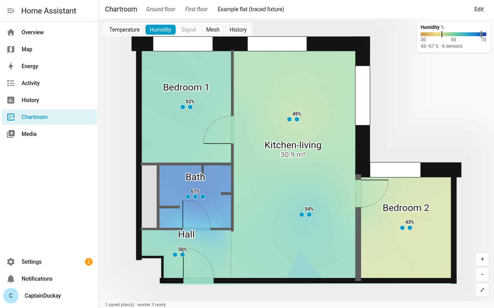

### Signal

**Signal** estimates the Wi-Fi or radio strength (dBm) you would get everywhere on the plan from
the access points and radios placed with **Source**:

- **Straight rays through your walls.** From each source, signal falls off with distance from its
  level at 1 m (path-loss exponent 2.2), and every wall the straight line crosses takes off its
  material's loss per centimetre times its thickness (**Materials** in the editor). Doors and
  windows have their own material and lose nothing while their entity says they are open. Each
  point shows the strongest source.
- **Level at 1 m** is set per source in the inspector (default -40 dBm for an access point,
  -45 dBm for a radio). A source whose entity is unavailable is left out.
- The scale is fixed from -90 dBm (violet, unusable) through red and amber to green (-30 dBm).
  The legend shows how many sources and wall segments are used, and how many were left out above
  the limits of 32 sources and 2048 wall segments.
- It is an estimate, not a measurement: there is no calibration to real RSSI yet.
- Drawn by a WebGL2 shader, or by the Web Worker on a 2D canvas, with the same results.

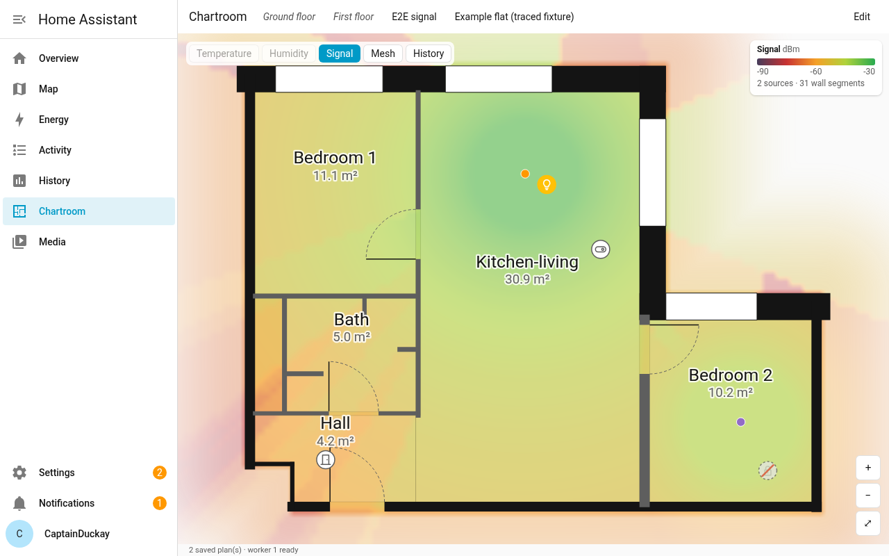

### Mesh links

**Mesh** draws the links between Zigbee and Z-Wave devices placed on the plan, as Home Assistant's
ZHA and Z-Wave JS integrations and Zigbee2MQTT (over MQTT) report them. Each line runs between two
placed devices (or sources) of the same network, coloured from red (weak) to green (strong) by
link quality (LQI) or RSSI, dashed grey when the network gives neither. Hover a line for the two
devices and the value. The note at the bottom left says how many links are on this plan and which
networks were found; a network that is not set up is simply skipped. The topology is read again
every minute while the layer is on (Zigbee2MQTT's network map at most every 10 minutes, since it
makes the routers scan). The toggle works with any heatmap or none, and is remembered on this
device.

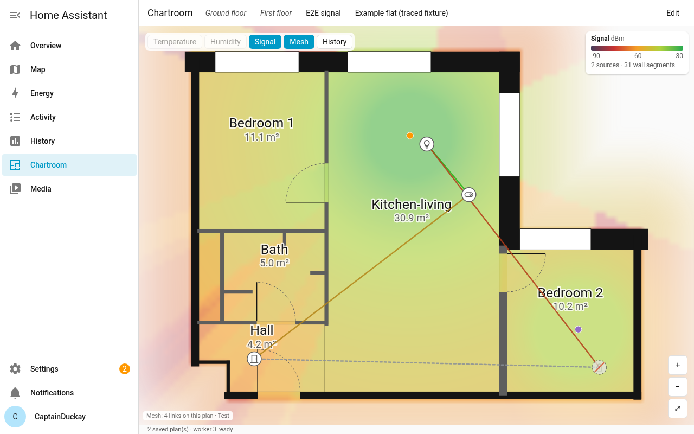

## History

**History** (next to the layer buttons) shows the plan as it was. A bar opens under the plan with
a time slider, **Play**/**Pause**, the ranges **6h**, **24h** and **7d**, and **Live**. While it is
open the plan has an orange frame, and everything on it follows the slider: the heatmaps move to
the recorded readings with the same smooth transition as live ones, device markers show their
recorded state, a source that was unavailable then drops out of the signal map, and doors and
windows with a sensor block heat and signal as they did then. Play runs through the range in about
30 seconds and stops at the end. **Live** closes the bar and returns to the current states.

- The data comes from Home Assistant's own websocket API: `history/history_during_period` for
  6h and 24h, and for 7d the hourly means from `recorder/statistics_during_period` for sensors
  that keep statistics (those with a `state_class`), with raw history for everything else.
  Only the plan's placed sensors, sources and devices, and its doors' and windows' sensors, are
  fetched.
- While you look at the past, tapping a marker opens its details instead of toggling it.
- The history code is loaded only when you first open it (1.8 KB gzip).
- What you can go back to depends on your recorder settings (`purge_keep_days`, 10 days by
  default); long-term statistics are kept beyond that.

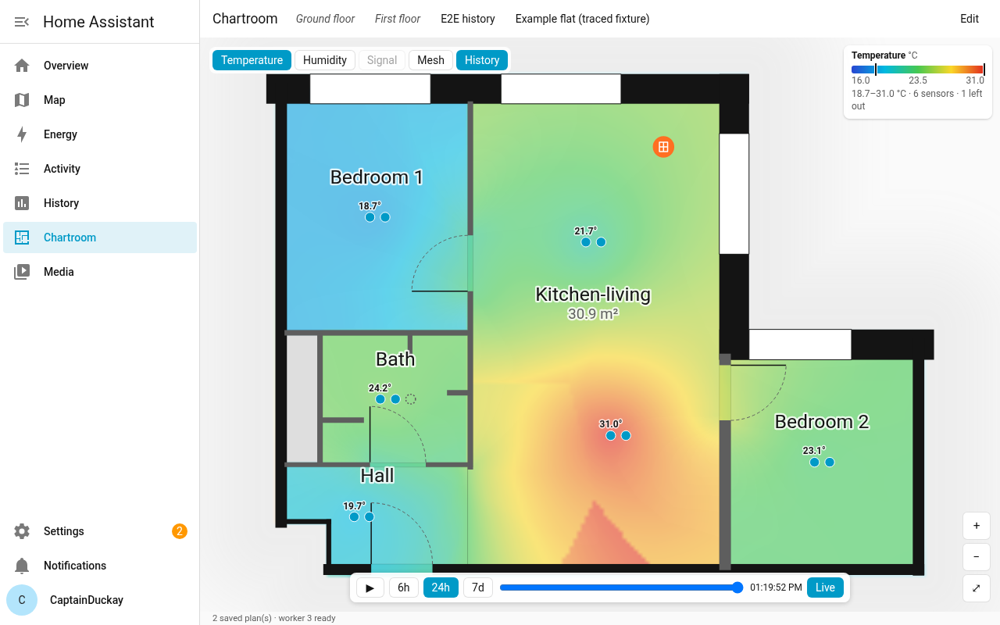

## On a phone

On a narrow screen (600 px or less, as in the Home Assistant companion apps) the panel gives the
plan the whole screen:

- The controls dock in a bottom sheet under the plan: layer buttons in one row you can swipe, the
  history bar with a full-width slider, and a handle that opens the rest (the underlay controls).
- Floors stay as tabs in the header, next to the button that opens Home Assistant's sidebar.
- One finger pans and two fingers pinch-zoom; **⤢** fits the plan again.
- The heatmap legend moves to the top left; markers and labels keep their on-screen size at any
  zoom, and buttons are at least 36 px tall for a finger.
- The sheet leaves room for the phone's home indicator (`safe-area-inset-bottom`).

<p>
  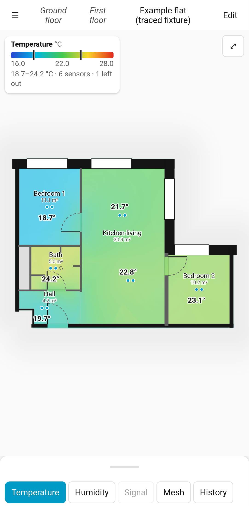
  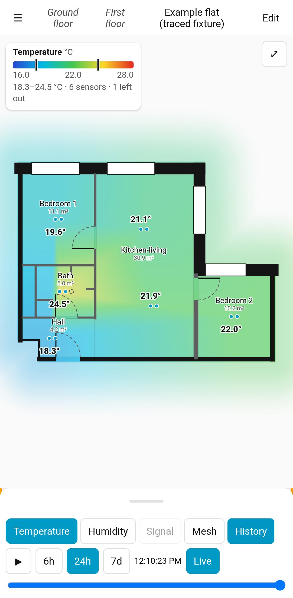
</p>

## Devices

Markers follow Home Assistant live, in the panel and in the card:

| Marker                              | Means                                                     |
| ----------------------------------- | --------------------------------------------------------- |
| Amber disc                          | A light, switch, fan or input boolean is on               |
| Deep-orange disc                    | A door, window or garage door is open (or opening)        |
| Blue disc                           | Motion detected                                           |
| Purple disc                         | A cover is open, opening or closing                       |
| Red disc / green outline            | A lock is unlocked / locked                               |
| White disc                          | Off, closed or clear                                      |
| Dashed, faded disc with a red slash | Unavailable (unknown: dashed, no slash)                   |
| Dashed ring                         | Waiting for Home Assistant to confirm the change you made |

- **Tap** (or Enter/Space on a focused marker) toggles lights, switches, fans and input booleans,
  opens or closes a cover (stops it while it moves) and locks or unlocks a lock after you confirm.
  Sensors and unavailable devices open their details instead.
- **Hold** (half a second), right-click, the context-menu key or Shift+F10 opens Home Assistant's
  more-info dialog.
- Markers keep the same size on screen at any zoom. Each one is a button with its entity's name
  and state as its label, for screen readers.
- The glyphs are Chartroom's own small SVG line drawings. Home Assistant's `ha-state-icon` would
  have to sit in a `foreignObject` inside the zoomable SVG, which renders unreliably in WebKit
  (Safari and the iOS companion app), so Chartroom does not use it.

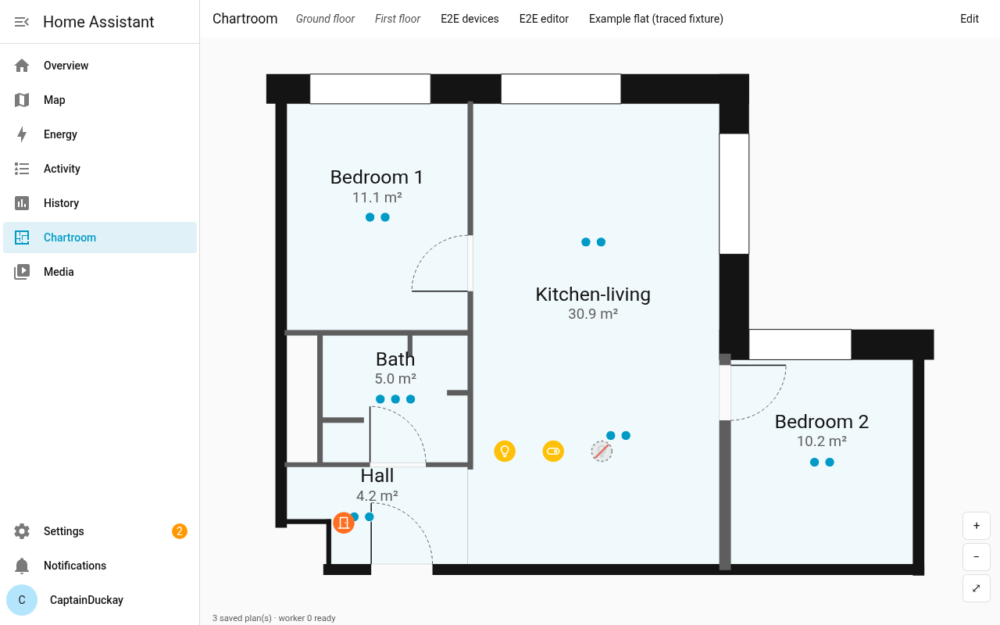

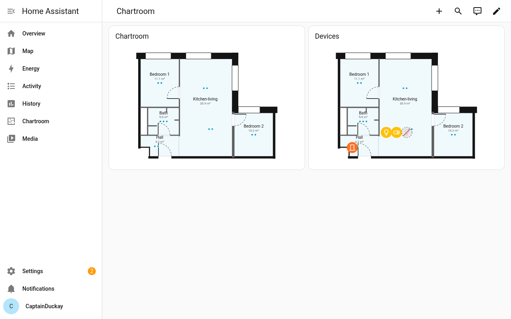

## Install

Chartroom needs Home Assistant 2026.10 or newer. Until it is in the default catalog, add it as a
custom repository: `https://github.com/captains-chest/chartroom`, type **Integration**.

**Home Assistant 2026.11 and newer (Marketplace).** HACS is built in as the
[Marketplace](https://www.hacs.xyz/docs/marketplace/) from 2026.11.

1. Go to **Settings → Marketplace** and accept the community-content warning the first time.
2. Add the repository under **Custom repositories** (type **Integration**). Custom repositories
   need a GitHub connection; the Marketplace asks you to connect one.
3. Download **Chartroom**, and restart Home Assistant if it asks you to.
4. Go to **Settings → Devices & services → Add integration → Chartroom**.

**Home Assistant 2026.10 (HACS).**

1. In HACS, open the ⋮ menu → **Custom repositories**, add the repository with type
   **Integration**.
2. Download **Chartroom** and restart Home Assistant.
3. Go to **Settings → Devices & services → Add integration → Chartroom**.

**By hand.** Copy `custom_components/chartroom` from this repository (or a release) into the
`custom_components` folder of your Home Assistant configuration, restart Home Assistant, and add
the integration as above. Updates are then up to you.

After an update (and the restart), a panel or card left open in a browser shows **Chartroom was
updated** with a **Reload** button: the page still runs the old frontend until it reloads. The
frontend is served from a path with the version in it, so no cache can hand out an old file.

Chartroom adds a **Chartroom** entry to the sidebar and registers the
`custom:chartroom-card` card — no separate dashboard resource is needed:

```yaml
type: custom:chartroom-card
title: Ground floor
floor_id: ground_floor # or plan_id: example; without either, the first plan
height: 320px # optional; in the sections view the grid sets the height
layer: temperature # optional: temperature, humidity, signal or none (the default)
layer_toggles: true # optional: show the layer buttons on the card
mesh: true # optional: draw mesh links
history: true # optional: a History button that opens the time slider
```

The card shows the plan with live device markers (tap to toggle, hold for details) and, with
`layer`, a heatmap. It does not pan or zoom, so the dashboard still scrolls over it; open the panel
to explore a plan. When a plan is edited, open cards update straight away. With `history: true`
the card gets the same History slider as the panel (loaded on first use); while you scrub, marker
colours fade from one state to the next.

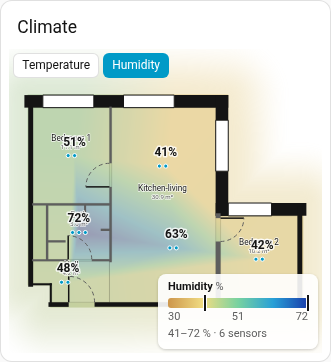

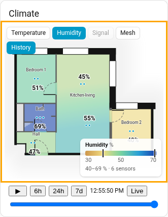

Requires Home Assistant 2026.10 or newer. Chartroom has no Python requirements and no runtime
JavaScript dependencies; everything it needs ships in this repository.

## What's inside

| Path                                                              | What                                                                                                                                                         |
| ----------------------------------------------------------------- | ------------------------------------------------------------------------------------------------------------------------------------------------------------ |
| `custom_components/chartroom/`                                    | The integration: config flow (single instance), plan storage, websocket API, panel, card.                                                                    |
| `custom_components/chartroom/frontend`                            | Built frontend, committed so HACS can serve it. Do not edit by hand.                                                                                         |
| `frontend/src/`                                                   | `<chartroom-panel>` and `<chartroom-card>`: TypeScript Web Components, no framework.                                                                         |
| `frontend/src/plan/`                                              | The plan schema: models, types, constants (limits, schema version), normalising and validation (`functions.ts`) and the editor's plan operations (`ops.ts`). |
| `frontend/src/editor/`                                            | The editor's pure parts: tools, snapping, item kinds and the autosaver. `plan-editor.ts` is its DOM side.                                                    |
| `frontend/src/heat/`                                              | The heatmap: one `FieldRenderer` interface with WebGL2 and Canvas2D renderers, the worker client, legend and value labels. `heat-layer.ts` drives it.        |
| `frontend/src/field.ts`, `field-plan.ts`, `signal.ts`             | The field maths, shared by the worker, the renderers and the tests.                                                                                          |
| `frontend/src/worker.ts`, `worker-protocol.ts`, `field-worker.ts` | The field worker, its messages, and starting it. Nothing it loads touches the DOM.                                                                           |
| `frontend/src/viewer.ts`, `api.ts`                                | What the panel and the card share around the plan view (`ViewerController`), and the websocket port (`ChartroomApi`).                                        |
| `frontend/src/geometry.ts`, `text.ts`, `ui.ts`                    | Pure geometry, pure text helpers, and DOM helpers.                                                                                                           |
| `.ci/configuration.yaml`                                          | The CI Home Assistant: template sensors, lights, switches, a lock and a cover for e2e.                                                                       |
| `tests/`, `frontend/test/`, `e2e/`                                | pytest, Vitest, and Playwright against a real Home Assistant.                                                                                                |

Websocket commands: `chartroom/info` (returns `{version}`, used for the update prompt), `chartroom/plans/list`, `chartroom/plans/get`, `chartroom/plans/save` and `chartroom/plans/delete` (save and delete need an admin; save rejects a plan whose `schema_version` this version does not know), and `chartroom/plans/subscribe`, which sends `{plan_id, deleted}` whenever a plan is saved or deleted. `chartroom/mesh/get` returns the mesh topology `{nodes, links, sources}` (`chartroom/mesh/test_source`, admin only, swaps in a fake one for tests). Underlay images live at `/api/chartroom/underlay/<plan_id>` (GET for any user, POST for admins; at most 10 MB). Each upload is kept as its own version, addressed by `?v=<hash>`, so the editor's Undo can go back to a replaced image; versions the plan no longer points at are deleted when Home Assistant starts and when the plan is deleted. The frontend sends the `chartroom/*` commands through one port, `ChartroomApi` in `frontend/src/api.ts`; the panel and the card share their viewer (layers, History slider, plan loading) in `frontend/src/viewer.ts`.

## Example data

[](https://raw.githubusercontent.com/captains-chest/chartroom/main/docs/images/example-plan.svg)

[`frontend/test/fixtures/example-plan.json`](https://github.com/captains-chest/chartroom/blob/main/frontend/test/fixtures/example-plan.json) is a real
one-floor flat of about 62 m², traced by hand into the plan model (`frontend/src/plan/models.ts`): walls in
metres with material and thickness, rooms, doors with their swing, windows, and sample
temperature/humidity sensors. Only the geometry and generic room types were kept; the source
drawing is not in the repository. Tests check each room against the area stated on the drawing.

```sh
pnpm example-plan                                   # regenerate the fixture and the SVG preview
HA_URL=http://127.0.0.1:8123 HA_TOKEN=... node scripts/example-plan/load-into-ha.mjs
```

The last command saves the fixture to a dev Home Assistant as plan `example` via
`chartroom/plans/save`.

## Development

Needs Node.js 24, pnpm and [uv](https://docs.astral.sh/uv/).

```sh
pnpm install
pnpm check          # format, lint, type-check (Vite+)
pnpm test           # Vitest
pnpm build          # builds into custom_components/chartroom/frontend — commit the result
pnpm size           # bundle-size budget

uv sync --group test --group lint --no-install-project
uv run ruff check . && uv run ruff format --check .
uv run pytest
```

End-to-end tests need a running Home Assistant with Chartroom copied into its
`custom_components`. They onboard a fresh instance, or use `HA_TOKEN` for an existing one:

```sh
pnpm exec playwright install chromium
HA_URL=http://127.0.0.1:8123 pnpm e2e
```

Playwright runs three projects: `chromium` (desktop), `phone` (a Pixel 7 viewport with touch,
for the phone layout) and `history`, which runs after the desktop tests because it records
readings far from the others' on the shared instance.

The frontend has no runtime dependencies and a size budget, checked by `pnpm size` in CI: the card
(with what it shares) 20 KB gzip and everything together 58 KB gzip. The heatmap renderer, editor,
mesh layer and history bar are separate chunks loaded when first used. The build squeezes the CSS,
GLSL and HTML in template literals (`scripts/minify-literals.ts`), which the JS minifier keeps
byte for byte.

`PERF=1 pnpm e2e e2e/perf.spec.ts` runs the CPU-throttled wall-tablet check (not in CI).

CI runs all of the above, plus hassfest and HACS validation, and starts Home Assistant in Docker
for the end-to-end tests.

## Credits and contact

Made by CaptainDuckay. Questions: hello@captains-chest.com.

## License

[MIT](https://github.com/captains-chest/chartroom/blob/main/LICENSE)
